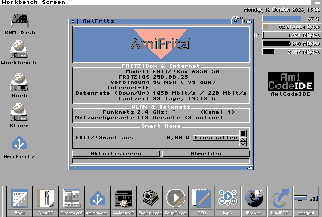

# AmiFritzi



Control an AVM FRITZ!Box from a classic Amiga: AmigaOS 3.x, 68020+, no FPU,
any `bsdsocket.library` stack (Roadshow, AmiTCP, Miami). Talks to the box's
official interfaces instead of scraping the web UI: the AHA HTTP interface
for smart home, and TR-064 (SOAP) for device, internet, WLAN, and home
network information.

Version 0.5. Until 0.25 the program was called AmiFritz; its saved settings
(`ENVARC:AmiFritz.prefs`) are still read.

The plan and the protocol details are in [PROJECT.md](PROJECT.md).

## Status

| Phase | What                                       | State |
|-------|--------------------------------------------|-------|
| 1     | TCP + HTTP over bsdsocket (`net.c`)        | done, tested against mock |
| 2     | MD5, `login_sid.lua` login, smart plugs    | done, tested against mock |
| 3     | TR-064: SOAP auth, service discovery, WAN IP, device info | done, tested against mock |
| 4     | MUI GUI with a separate network process    | done, runs on a 68030 (TF536) with a FRITZ!Box 6850 5G |

## AmiFritzi (MUI)

A login window asks for the box (default `fritz.box`), the user, and the
password. With the user left empty, AmiFritzi uses the user the box reports
as last logged in. After a successful login, host, user, and password are
saved to `ENV:`/`ENVARC:AmiFritzi.prefs`, and the next start logs in
straight away. **The password is stored in plain text** in that file, so
anyone with access to the Amiga can read it. To forget it, delete
`ENVARC:AmiFritzi.prefs`.

After login, the main window shows, through TR-064 (shown as `-` when TR-064
is off):

- model, FRITZ!OS version, and uptime
- connection (DSL status, or mobile technology and signal on 5G/LTE boxes),
  internet address, and line speed
- 2.4 GHz WLAN with SSID and channel
- number of devices in the home network and how many are online

plus a table of all smart plugs with name, state, power, and an on/off
button. The plugs are re-read every 30 seconds. When the session ID expires
(after 20 minutes idle, or after the box reboots), AmiFritzi logs in again
without asking. The menu has About, Settings (back to the login window), and
Quit.

All network access runs in its own process ("AmiFritzi Netz"). The GUI sends
it jobs as Exec messages and gets the results back in the same message, so
windows stay responsive while the box answers, for up to the 15-second
timeout. Buttons are disabled while a job runs. See `worker.h` and `jobs.h`.

## AmiFritziCLI

```
AmiFritziCLI [-h host] [-P port] [-T tr064port] [-u user] [-p pass] <command> [arg...]
  get <path>          raw HTTP GET, print status line and headers (phase 1)
  login               log in, print SID, log out
  list                list smart plugs: AIN, state, power, name
  on|off|toggle <AIN> switch a smart plug
  info                model, FRITZ!OS version, uptime (TR-064)
  wanip               current internet address (TR-064)
  soap <service> <action>  call any TR-064 action without arguments,
                      print the raw reply, e.g. soap DeviceInfo:1 GetInfo
```

TR-064 must be enabled on the box: Home Network > Network > Network
Settings > "Allow access for applications". The user needs the right
"FRITZ!Box settings" for most actions.

The host defaults to `fritz.box`. Without `-u`, the CLI uses the user the box
reports as last logged in (FRITZ!OS 7.24+ always needs a username). The
password may also come from the environment variable `FRITZPASS`; without
`-p` and `FRITZPASS`, host, user, and password are taken from the GUI's
`AmiFritzi.prefs`. Put the AIN
in quotes, because it contains a space: `AmiFritziCLI on "08761 0000434"`.

## Building

For the Amiga, cross-compile with
[m68k-amigaos-gcc](https://github.com/AmigaPorts/m68k-amigaos-gcc). This uses
the same profile as AmiHomeassist:

```sh
make                              # AmiFritzi (MUI) + AmiFritziCLI
make DEBUG=1                      # with a diagnostic log in RAM:AmiFritzi.log
make check-fpu                    # verify the binaries contain no FPU code
make TOOLCHAIN=/path/to/m68k-amigaos-gcc
```

As in AmiHomeassist, MUI's developer headers are not in the repository,
because MUI's licence only allows redistributing the complete archive. Put
them under `vendor/mui/include/`. Only MUI's built-in classes are used, so
NList is not needed. `muistubs.c` comes from
[amimcp](https://github.com/thomas-luebker/amimcp) and is under Apache 2.0
([LICENSE-Apache-2.0](LICENSE-Apache-2.0)).

## Tests without hardware

The network code builds unchanged on Linux and macOS with BSD sockets.
`make test` builds a host binary and checks:

- MD5 against the RFC 1321 vectors
- the TR-064 response against the worked example in PROJECT.md
- the `login_sid.lua` response against AVM's own example (`äbc`)
- the complete CLI against `tests/mockbox.py`, a mocked FRITZ!Box that
  implements `login_sid.lua`, the AHA plug commands, and TR-064 with AVM's
  SOAP auth, including single-use nonces
- the network process's job logic (`jobs.c`) against the same mock,
  including the silent re-login after the SID expires

To try the mock by hand, run `python3 tests/mockbox.py 8080 49000`, then
`build/host/AmiFritziCLI -h 127.0.0.1 -P 8080 -p gurkensalat list` or `info`.

## Notes

- `login_sid.lua` is called without `version=2`, so the box sends the MD5
  challenge rather than PBKDF2. PBKDF2 would need SHA-256 and thousands of
  iterations, which is too slow on a 68020. AVM still accepts MD5.
- Passwords are ISO-8859-1, the Amiga charset. For the UTF-16LE hash, each
  character becomes `byte, 0x00`. For TR-064, user and password are
  converted to UTF-8 before hashing. Names coming from the box (UTF-8) are
  converted to Latin-1 for display.
- TR-064 uses AVM's SOAP auth in the SOAP header, not HTTP digest. Every
  reply carries the nonce for the next call, so after the first call each
  further call needs only one request.
- HTTP/1.0 with `Connection: close` means the box never answers with chunked
  encoding. The reader stops at `Content-Length` or when the connection
  closes, whichever comes first.
- `bsdsocket.library` is opened on the first request by the task that uses
  the network, because the library base is per task, and closed again with
  `net_cleanup()` when that task ends. In the GUI program only the network
  process ever opens it.
- The number of online devices comes from the host list the box offers as
  one file (`X_AVM-DE_GetHostListPath`), not from one SOAP call per device.
- `make push` copies the binaries to an Amiga running amiagent. Its host,
  token, and amimcp path go in `push_local.py` (not in git) or in the
  environment variables `AMIGA_HOSTS`, `AMIGA_TOKEN`, and `AMIMCP_PATH`.
- Memory that crosses between the GUI and the network process comes from
  `AllocVec()` (`mem.c`), not libnix `malloc()`, because the libnix
  allocator has no locking.
